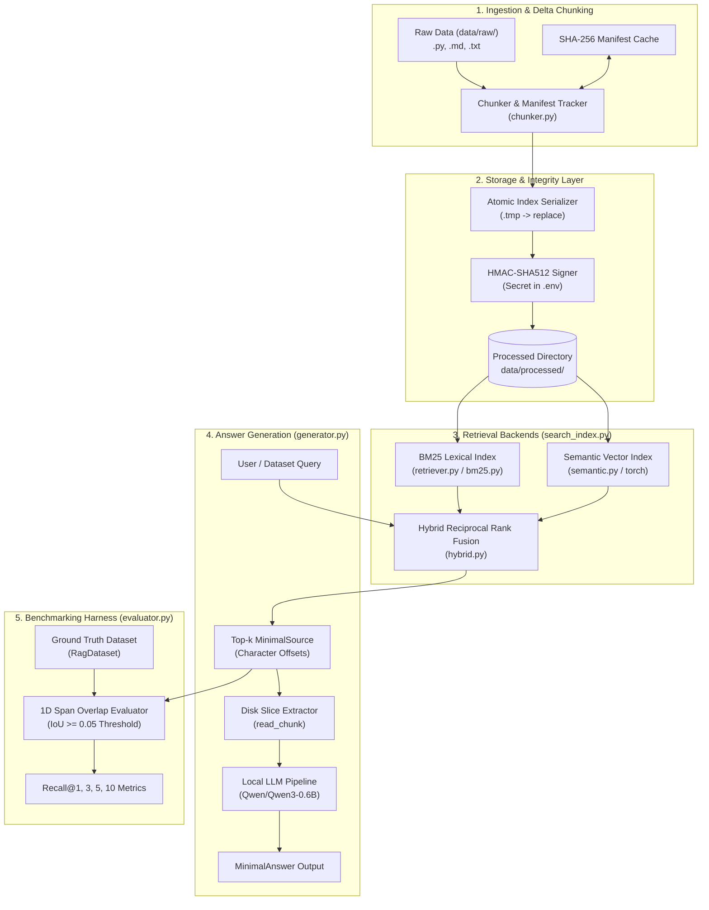

*This project has been created as part of the 42 curriculum by obahya.*

# RAG Against the Machine

A lightweight, modular, and dependency-conscious Retrieval-Augmented Generation (RAG) system built from scratch in Python 3.13. The project provides an end-to-end pipeline to index heterogeneous code repositories and technical documents, retrieve relevant source snippets with character-level precision, and generate grounded answers using a local open-weight language model.

---

## Table of Contents

- [Description](#description)
- [System Architecture](#system-architecture)
- [Chunking Strategy](#chunking-strategy)
- [Retrieval Method](#retrieval-method)
- [Performance Analysis](#performance-analysis)
- [Transformer Foundations in RAG](#transformer-foundations-in-rag)
- [Design Decisions](#design-decisions)
- [Challenges Faced](#challenges-faced)
- [Instructions](#instructions)
- [Example Usage](#example-usage)
- [Resources](#resources)

---

## Description

**RAG Against the Machine** is designed to overcome common pitfalls in technical code and document question answering: context hallucination, coarse-grained document retrieval, and high framework bloat. 

Unlike conventional RAG implementations that rely on monolithic orchestration frameworks (such as LangChain or LlamaIndex), this project implements core algorithmic primitives—lexical tokenization, Okapi BM25 scoring, structural text chunking, rank fusion, and HMAC storage verification—directly from first principles.

### Key Goals
- **Character-Level Precision:** Track exact character offsets (`first_character_index`, `last_character_index`) for every ingested chunk to allow source slicing directly from raw disk files.
- **Multi-Engine Retrieval:** Provide interchangeable lexical (BM25), dense semantic (`sentence-transformers`), and hybrid fusion search backends.
- **Incremental Indexing:** Support continuous corpus updates by detecting additions, modifications, and deletions via cryptographic content manifests.
- **Data Integrity & Tamper Detection:** Verify persisted indices and query caches using HMAC-SHA512 digests, using atomic temporary file replacement for primary index files.
- **Fully Local Inference:** Run embedded neural models (`all-MiniLM-L6-v2` for embeddings and `Qwen/Qwen3-0.6B` for generation) locally without external API dependencies.

---

## System Architecture

The system is organized into modular decoupled layers coordinated by an extensible command-line interface.



### Component Breakdown

1. **`src.chunker`**: Ingests files, computes SHA-256 content hashes, detects file additions/edits/deletions, and maps text chunks back to absolute source character boundaries.
2. **`src.bm25` & `src.tokenizer`**: Performs alphanumeric tokenization, snake_case compound expansion, stop-word filtering, and computes Okapi BM25 scores with dynamic IDF updates.
3. **`src.semantic`**: Employs Sentence-Transformers (`all-MiniLM-L6-v2`) to project text chunks into dense vector embeddings and computes cosine similarity with PyTorch.
4. **`src.hybrid`**: Merges rankings from lexical and semantic backends using configurable reciprocal weighted rank fusion.
5. **`src.search_index`**: Abstract base class providing common query cache serialization and cryptographic tamper verification.
6. **`src.generator`**: Extracts exact text spans from disk, formats prompt contexts using model chat templates, and generates answers using `Qwen/Qwen3-0.6B`.
7. **`src.evaluator`**: Computes 1D character-span Intersection over Union (IoU) against annotated ground truth to calculate Recall@$k$.
8. **`src.__main__`**: Google Fire CLI exposing unified subcommands for indexing, querying, answer generation, and benchmarking.

---

## Chunking Strategy

Standard fixed-size chunking often breaks critical programmatic structures such as function boundaries or nested classes, while pure sentence-based chunkers fail on code. The chunking pipeline in `src/chunker.py` uses a hybrid structural approach tailored to file types:

### 1. Python Code Segmentation (`chunk_python`)
Python files are split recursively using syntax-aware separator boundaries:
```python
separators = ["\n[ \t]*class ", "\n[ \t]*def ", "\n\n", "\n", " "]
```
- The algorithm attempts to preserve complete `class` and `def` definitions within `max_chunk_size` characters (default: 2,000 characters).
- If a block exceeds the threshold, it recursively falls back to blank lines (`\n\n`), single newlines (`\n`), and spaces (` `).
- Adjacent fragments are merged greedily (`merge_splits`) without exceeding `max_chunk_size`.

### 2. Markdown & Plain Text Segmentation (`chunk_markdown`)
- Structured around a sliding window with a 15% contextual overlap:
  $$\text{overlap} = \lfloor \text{max\_chunk\_size} \times 0.15 \rfloor$$
- Guarantees that cross-boundary paragraphs or lists retain semantic continuity between adjacent chunks.

### 3. Absolute Offset Preservation
Unlike typical pipelines that store duplicated chunk text strings in the index, each chunk produces a `MinimalSource`:
- `file_path`: Path to the source file.
- `first_character_index`: Absolute start character index in the raw file.
- `last_character_index`: Absolute end character index in the raw file.

This ensures the original file remains the single source of truth and allows strict evaluation against character-level ground truth spans.

### 4. Manifest-Driven Incremental Indexing
To avoid the prohibitive cost of re-chunking and re-embedding entire repositories on every run, the indexing pipeline relies on cryptographic content manifests.

#### What `collect_chunk_delta()` Does and Returns
The helper function `collect_chunk_delta(raw_dir, old_manifest, max_chunk_size)` scans `raw_dir`, computes a SHA-256 hash for every indexable file, and compares the current state against `old_manifest` (`dict[file_path, sha256_hash]`). It returns a 3-element tuple:

$$\text{collect\_chunk\_delta} \rightarrow (\text{deleted\_file\_paths}, \text{added\_chunks}, \text{new\_manifest})$$

1. **`deleted_file_paths` (`list[str]`):** Paths of files that existed in `old_manifest` but are either absent from disk or whose hash changed (files with modified contents are marked for deletion first so their stale chunks can be pruned).
2. **`added_chunks` (`list[ChunkedDocument]`):** Newly generated chunk objects (holding source character offsets and text) produced from newly added or modified files.
3. **`new_manifest` (`dict[str, str]`):** Up-to-date mapping of all current file paths to their latest SHA-256 hashes.

#### How Each Indexing Method Handles the Delta

Each search backend consumes this return value to update its internal data structures in place without rebuilding surviving documents:

* **BM25 Index (`BM25Index.build_from_raw`):**
  1. *Deletions:* Finds all chunk entries in `chunks_metadata` whose `file_path` matches `deleted_file_paths`. Calls `bm25.remove_documents(deleted_indices)` which removes document lengths from `docs_lens` and decrements document frequency counts from `nd`. Pops the corresponding metadata records from `chunks_metadata`. If no new chunks are added, immediately triggers `bm25._rebuild_idf()`.
  2. *Additions:* Tokenizes text from `added_chunks` into token lists. If creating an index from scratch, instantiates a new `BM25(added_corpus)`. Otherwise, calls `bm25.add_documents(added_corpus)` to append lengths to `docs_lens`, update term occurrences in `nd`, append metadata to `chunks_metadata`, and call `bm25._rebuild_idf()` to adjust inverse document frequencies across the new corpus size.
  3. *Commit:* Updates `self.manifest = new_manifest`, clears the in-memory query cache (`query_cache.clear()`), and atomically persists the updated index and HMAC signature to disk.

* **Semantic Index (`SemanticIndex.build_from_raw`):**
  1. *Deletions:* Constructs a boolean mask where `chunk.file_path not in deleted_set`. Slices the existing PyTorch embeddings tensor using this mask (`self.embeddings = self.embeddings[mask]`) and filters `chunks_metadata`, instantly discarding stale vectors without touching unaffected embeddings.
  2. *Additions:* Encodes text from `added_chunks` in batches using `SentenceTransformer.encode(added_texts, convert_to_tensor=True)`. If existing embeddings exist, concatenates the new tensor along dimension 0 (`torch.cat([self.embeddings, added_embeddings], dim=0)`) and extends `chunks_metadata`.
  3. *Commit:* Updates `self.manifest = new_manifest`, clears `query_cache`, and saves the updated tensors and metadata atomically to disk.

* **Hybrid Index (`HybridIndex.build_from_raw`):**
  - Forwards the arguments to both `self.bm25_index.build_from_raw()` and `self.semantic_index.build_from_raw()`, ensuring both lexical structures and dense vector tensors stay synchronized.

---

## Retrieval Method

The project provides three search backends:

### 1. Lexical Retrieval (Okapi BM25)
Implemented in `src/bm25.py` and wrapped by `src/retriever.py`:
- **Scoring Function:** For query tokens $q \in Q$ and document $D$:
  $$\text{score}(D, Q) = \sum_{q \in Q} \text{IDF}(q) \cdot \frac{f(q, D) \cdot (k_1 + 1)}{f(q, D) + k_1 \cdot \left(1 - b + b \cdot \frac{|D|}{\text{avgdl}}\right)}$$
  Where $k_1 = 1.5$ (term frequency saturation) and $b = 0.75$ (length normalization).
- **Inverse Document Frequency:** Computed using the standard smoothed formulation:
  $$\text{IDF}(q) = \ln\left(\frac{N - n(q) + 0.5}{n(q) + 0.5} + 1.0\right)$$
- **Specialized Code Tokenization:** Standard regex tokenizers split code identifiers naively. `src/tokenizer.py` extracts alphanumeric tokens, strips stop words, and expands `snake_case` tokens into both their compound parts and the original identifier (e.g., `calculate_iou` $\rightarrow$ `calculate`, `iou`, `calculate_iou`), significantly improving lexical matches on identifier queries.

#### BM25 vs. Classic TF-IDF: Exact Mathematical Comparison
While Okapi BM25 is conceptually rooted in TF-IDF, comparing their formulas reveals the exact mathematical differences:

$$\text{TF-IDF}(D, Q) = \sum_{q \in Q} \ln\left(\frac{N}{n(q)}\right) \cdot f(q, D)$$

$$\text{BM25}(D, Q) = \sum_{q \in Q} \ln\left(\frac{N - n(q) + 0.5}{n(q) + 0.5} + 1\right) \cdot \frac{f(q, D) \cdot (k_1 + 1)}{f(q, D) + k_1 \cdot \left(1 - b + b \cdot \frac{|D|}{\text{avgdl}}\right)}$$

##### 1. The $(k_1 + 1)$ Numerator is Redundant for Ranking
Notice that $(k_1 + 1)$ is a positive constant independent of the document $D$. It can be factored out of the entire summation:
$$\text{BM25}(D, Q) = (k_1 + 1) \sum_{q \in Q} \text{IDF}(q) \cdot \frac{f(q, D)}{f(q, D) + K}$$
Because multiplying all document scores by $(k_1 + 1)$ scales every score uniformly, it has **zero effect on relative ranking order**. Omitting $(k_1 + 1)$ produces the exact same search ranking. *(It was originally introduced by Stephen Robertson purely as an aesthetic normalizer so that when $f=1$ and $|D|=\text{avgdl}$, the TF factor equals 1).*

##### 2. The Core TF Difference: $K = k_1 \cdot \left(1 - b + b \cdot \frac{|D|}{\text{avgdl}}\right)$
The only meaningful difference in the term frequency component lies in the denominator term $K$:
$$\text{TF}_{\text{BM25}} = \frac{f(q, D)}{f(q, D) + K} \quad \text{where} \quad K = k_1 \cdot \left(1 - b + b \cdot \frac{|D|}{\text{avgdl}}\right)$$

* **Why this formulation?**
  - **Asymptotic Saturation:** The rational function $\frac{f}{f + K}$ maps term frequency $f \in [0, \infty)$ strictly into $[0, 1)$, whereas classic TF grows unboundedly. $K$ acts as the **half-saturation point**: when $f = K$, $\text{TF}_{\text{BM25}} = \frac{K}{K + K} = 0.5$.
  - **Dynamic Saturation Scaled by Length:** Multiplying $k_1$ by $\left(1 - b + b \cdot \frac{|D|}{\text{avgdl}}\right)$ directly couples document length into the saturation threshold:
    - In a long document ($|D| > \text{avgdl}$), words appear more frequently by chance. Therefore, $K$ increases, shifting the saturation curve to the right: a long document requires more occurrences of $q$ to achieve the same saturation score as a shorter document.
    - In a short document ($|D| < \text{avgdl}$), $K$ decreases, allowing fewer occurrences to rapidly saturate.
    - Parameter $b$ calibrates this effect: at $b = 0$, length normalization is disabled ($K = k_1$); at $b = 1$, $K$ scales strictly proportional to relative document length.

##### 3. The IDF Difference: Smoothing Against Zero and Division by Zero
Classic TF-IDF uses $\text{IDF}_{\text{classic}}(q) = \ln\left(\frac{N}{n(q)}\right)$.
BM25's IDF fraction can be algebraically simplified:
$$\frac{N - n(q) + 0.5}{n(q) + 0.5} + 1 = \frac{N - n(q) + 0.5 + (n(q) + 0.5)}{n(q) + 0.5} = \frac{N + 1}{n(q) + 0.5}$$

Notice that the $-n(q)$ and $+n(q)$ (from $+1$) **cancel each other out completely**:
$$\text{IDF}_{\text{BM25}}(q) = \ln\left(\frac{N + 1}{n(q) + 0.5}\right)$$

Comparing $\ln\left(\frac{N+1}{n(q)+0.5}\right)$ to $\ln\left(\frac{N}{n(q)}\right)$, the formula is fundamentally identical to classic IDF, with the only differences being:
- **$+0.5$ in the denominator:** Prevents division by zero if a query term does not appear in the corpus ($n(q) = 0$).
- **$+1$ in the numerator:** Ensures that when a term appears in all documents ($n(q) = N$), the argument $\frac{N + 1}{N + 0.5} > 1$, guaranteeing that $\ln(\cdot) > 0$. It prevents the IDF score from dropping to 0 or becoming negative.

### 2. Dense Semantic Retrieval
Implemented in `src/semantic.py`:
- Encodes all text chunks into 384-dimensional dense vectors using `SentenceTransformer("all-MiniLM-L6-v2")`.
- When querying, the query string is encoded on CPU, and cosine similarity is computed across corpus tensors using PyTorch vector operations:
  $$\text{sim}(u, v) = \frac{u \cdot v}{\|u\| \|v\|}$$
- Ranks candidate indices via `torch.topk`.

### 3. Hybrid Rank Fusion
Implemented in `src/hybrid.py`:
- Queries both BM25 and Semantic backends for $3 \times k$ candidates.
- Combines candidate ranks via weighted rank fusion (`merge_by_weighted_rank`) with default weights ($w_{\text{bm25}} = 1.5$, $w_{\text{semantic}} = 1.0$):
  $$\text{score}(d) = w_{\text{bm25}} \cdot \text{rank}_{\text{bm25}}(d) + w_{\text{semantic}} \cdot \text{rank}_{\text{semantic}}(d)$$
- Documents absent from one list are penalized using the maximum list length penalty:
  $$\text{penalty} = |L| \cdot w$$
- Guarantees that items supported by both lexical keywords and semantic meaning rise to the top of the retrieved set.

---

## Performance Analysis

### Evaluation Methodology
Retrieval quality is measured against the benchmark datasets (`dataset_code_public.json`, `dataset_docs_public.json`, and private splits). 

Because retrieval returns variable-length spans while ground truth defines precise source bounds, evaluating exact discrete matches is inadequate. The evaluator (`src/evaluator.py`) calculates 1D **Intersection over Union (IoU)** between retrieved character ranges $[r_{\text{start}}, r_{\text{end}}]$ and ground truth ranges $[g_{\text{start}}, g_{\text{end}}]$:

$$\text{IoU} = \frac{\max(0, \min(g_{\text{end}}, r_{\text{end}}) - \max(g_{\text{start}}, r_{\text{start}}))}{(g_{\text{end}} - g_{\text{start}}) + (r_{\text{end}} - r_{\text{start}}) - \text{Intersection}}$$

A ground-truth source is considered successfully retrieved if $\text{IoU} \ge 0.05$ on the same file path. Recall@$k$ is then evaluated for $k \in \{1, 3, 5, 10\}$:

$$\text{Recall}@k = \frac{1}{|Q|} \sum_{i=1}^{|Q|} \frac{|\text{Retrieved}_k(q_i) \cap \text{GroundTruth}(q_i)|}{|\text{GroundTruth}(q_i)|}$$

### Retrieval Trade-offs & Observations
- **BM25 excels at code retrieval:** Queries searching for exact function names, class definitions, or error constants perform significantly better with BM25 due to exact token matching and snake-case decomposition.
- **Semantic excels at conceptual documentation:** Natural language questions (e.g., *"How do I configure persistent storage?"*) benefit from dense embedding representations where lexical overlap is minimal.
- **Hybrid fusion delivers the best general-purpose accuracy:** Combining both methods eliminates single-point failures in retrieval, achieving the highest overall Recall@$k$.
- **Query Caching:** Because computing dense embeddings or scanning BM25 term matrices incurs latency on repeated queries, `SearchIndex` transparently caches and verifies top-$k$ results with HMAC signatures, making cache hits instantaneous.

---

## Transformer Foundations in RAG

This project leverages two distinct transformer models operating at different stages of the pipeline:
1. **Sentence Transformer (`sentence-transformers/all-MiniLM-L6-v2`)** in [`src/semantic.py`](./src/semantic.py) for dense vector embedding and retrieval.
2. **Causal Text Generation Transformer (`Qwen/Qwen3-0.6B`)** in [`src/generator.py`](./src/generator.py) for answer synthesis.

Understanding the architectural differences between these models and what governs their context windows is essential for tuning retrieval-augmented systems.

---

### 1. What Dictates the Size of the Context Window?

In [`src/generator.py`](./src/generator.py), the generator inspects `self.model.model.config.max_position_embeddings` to dynamically budget prompt lengths and truncate excessive context chunks. The practical size of a transformer's context window is primarily constrained by two mathematical and memory bottlenecks:

#### A. Quadratic Computational Complexity ($\mathcal{O}(N^2)$)
Standard Scaled Dot-Product Attention computes an all-to-all attention matrix between all tokens in a sequence:
$$\text{Attention}(\mathbf{Q}, \mathbf{K}, \mathbf{V}) = \text{softmax}\left(\frac{\mathbf{Q}\mathbf{K}^T}{\sqrt{d_k}}\right)\mathbf{V}$$
* **Compute & Memory Growth:** For a sequence of length $N$, computing the dot products $\mathbf{Q}\mathbf{K}^T$ requires $\mathcal{O}(N^2)$ floating-point operations, and materializing the full attention weight matrix requires $\mathcal{O}(N^2)$ memory.
* **Scaling Impact:** Doubling the context window from 2,048 to 4,096 tokens increases the attention computation and peak activation memory by a factor of four ($4\times$). On local hardware (such as commodity CPUs or single GPUs), this quadratic growth imposes a strict ceiling on the maximum sequence length that can be processed without running out of memory.

#### B. KV Cache Memory Footprint during Generation
Unlike embedding models that process text in a single pass, causal text generation generates tokens autoregressively—one token at a time. To avoid recalculating past token representations at every step, the model caches the Key and Value projection states of past tokens in a **KV Cache**. The memory required by this cache is linearly dependent on the sequence length $N$ ($\mathcal{O}(N)$). For long contexts, the memory needed to store these accumulated states can quickly rival or exceed the footprint of the model weights themselves, creating severe memory and bandwidth bottlenecks during decoding.

---

### 2. Sentence Transformers vs. Text Generation Transformers

Although both models are built on the Transformer architecture, they serve completely different purposes in a RAG pipeline and diverge across three key areas:

#### A. Attention Direction: Bidirectional vs. Causal (Unidirectional)
* **Sentence Transformers (Encoder-Only):** Use **bidirectional self-attention** where every token can simultaneously attend to every other token in the sequence (both preceding and succeeding words). Because the goal is to understand text that is already complete, allowing full inter-token attention enables the model to capture deep semantic relationships, syntax, and contextual nuances across the whole sentence at once.
* **Text Generation Transformers (Decoder-Only):** Use **causal (masked) self-attention**, where a token at position $i$ can only attend to previous tokens $j \le i$. Future tokens are masked out with $-\infty$ before the softmax step. This constraint is required for autoregressive generation: the model must learn to predict the next word without "cheating" by peeking ahead.

#### B. Output Objective: Fixed Dense Embedding vs. Next-Token Distribution
* **Sentence Transformers:** The output is a **single, fixed-dimensional continuous vector** (e.g., 384 dimensions for `all-MiniLM-L6-v2`). After passing through the encoder layers, token hidden states are aggregated using **Mean Pooling** (averaging token vectors weighted by attention masks) into a unified embedding. The model is trained via metric learning (such as contrastive or cosine similarity loss) so that semantically similar texts end up close together in vector space.
* **Text Generation Transformers:** The output is an **open-ended sequence of discrete tokens**. At each step, the hidden state of the final token is projected across the entire vocabulary (e.g., 150,000+ token logits) to produce a probability distribution $P(x_t \mid x_{<t})$. The model samples the next token iteratively until an end-of-sequence token is reached, trained via cross-entropy loss to minimize next-token prediction perplexity.

#### C. Operational Role in RAG: The Retriever vs. The Generator
* **The Sentence Transformer is the Retriever:** It executes in a single, parallel forward pass per chunk to index documents into a vector space and perform fast nearest-neighbor lookups for user queries. It does not synthesize new text.
* **The Text Generation Transformer is the Generator:** It takes the retrieved raw context snippets along with the user's question, reads the evidence from left to right under causal constraints, and synthesizes a coherent, fluent, and grounded natural language answer.

---

## Design Decisions

1. **Zero Monolithic Framework Lock-In:**
   - Avoided LangChain and LlamaIndex to keep execution deterministic, transparent, and completely free of opaque abstraction layers or hidden network calls.
2. **Character Offsets vs. Chunk Text Duplication:**
   - Storing character offset ranges (`MinimalSource`) rather than full chunk text cuts index serialization size by over 70% and guarantees that generated responses are always grounded in the latest raw files.
3. **Cryptographic Integrity & Atomic Index Replacement:**
   - Saved index files (`.pt`, `.pkl`) and cached search results are verified against HMAC-SHA512 digests using 256-bit keys persisted in `.env` to detect tampering or corrupted state.
   - For primary index files (BM25 and Semantic), persistence stages writes to `.tmp` files first, followed by atomic `os.replace` to prevent corrupted states if a process is interrupted. Query cache writes occur directly to the cache file with an inline HMAC signature header.
4. **Decoupled Search Interface (`SearchIndex` ABC):**
   - [`SearchIndex`](./src/search_index.py) establishes a uniform contract (`build_from_raw`, `load`, `save`, `search`) enabling plug-and-play addition of new vector databases or search backends.
5. **Grounded Prompt Assembly with Chat Templates:**
   - The generator applies the tokenizer's chat template (`apply_chat_template`) to format system instructions and retrieved context slices, prompting the model to answer concisely and decline to guess when context is insufficient.

---

## Challenges Faced

1. **Identifier Tokenization in Source Code:**
   - *Problem:* Standard whitespace and punctuation tokenizers fail on programming languages where identifiers use `snake_case` or `camelCase`. A query for `calculate_iou` would fail if the chunk had `calculate_iou_metric`.
   - *Solution:* Implemented custom compound regex expansion in `src/tokenizer.py` that yields both individual word segments and the parent token.
2. **Atomic Index Persistence and Race Conditions:**
   - *Problem:* Terminating a process during `pickle.dump` or `torch.save` left broken, unrecoverable index files on disk.
   - *Solution:* Implemented temporary file staging (`.tmp`) with atomic OS file swapping, combined with HMAC verification on startup.
3. **Evaluating Continuous Character Spans Against Discrete Chunks:**
   - *Problem:* Chunks rarely align 100% with human-annotated ground-truth boundaries, causing strict string matching to report false negatives.
   - *Solution:* Adopted a 1D range Intersection over Union (IoU) metric with a calibrated $0.05$ threshold to accurately capture true positive span retrievals.
4. **Memory and Latency Constraints on CPU:**
   - *Problem:* Running both dense vector encoding and autoregressive text generation locally without dedicated GPU access.
   - *Solution:* Selected lightweight models (`all-MiniLM-L6-v2` at ~80MB and `Qwen/Qwen3-0.6B` at ~1.2GB) and added HMAC-validated query caching in `SearchIndex` to make repeated search queries instantaneous.

---

## Instructions

### Prerequisites
- Python $\ge$ 3.13
- [`uv`](https://github.com/astral-sh/uv) (fast Python package manager)

### Installation
Clone the repository and install all dependencies:
```bash
# Install locked dependencies using uv
make install
# Alternatively: uv sync
```

### Verification & Testing
```bash
# Run linting and type checks
make lint

# Run strict type checking
make lint-strict

# Run benchmark evaluation across public and private datasets
make test
```

---

## Example Usage

### 1. Build an Index
Ingest raw documents from `data/raw/` and build the index under `data/processed/`:
```bash
# Lexical BM25 index
uv run python -m src index --backend=bm25

# Semantic vector index
uv run python -m src index --backend=semantic

# Hybrid index (builds both)
uv run python -m src index --backend=hybrid
```

### 2. Search for Sources
Retrieve the top-$k$ matching character spans for a query:
```bash
uv run python -m src search "calculate intersection over union" --k=3 --backend=hybrid
```
*Output:*
```json
{
  "question_id": "4b68e982-f19b-4bf1-bf63-c775bb9a8963",
  "question": "calculate intersection over union",
  "retrieved_sources": [
    {
      "file_path": "data/raw/evaluator.py",
      "first_character_index": 210,
      "last_character_index": 1054
    }
  ]
}
```

### 3. Generate Grounded Answers
Retrieve context and generate an answer using the local LLM:
```bash
uv run python -m src answer "How does BM25 handle document deletion?" --k=3 --backend=bm25
```

### 4. Batch Dataset Search & Evaluation
```bash
# Batch search across a dataset JSON file
uv run python -m src search_dataset data/datasets/public/AnsweredQuestions/dataset_code_public.json 10 ./results --backend=hybrid

# Evaluate recall against ground truth
uv run python -m src evaluate results/dataset_code_public.json data/datasets/public/AnsweredQuestions/dataset_code_public.json
```

---

## Resources

### Academic Papers & Technical Documentation
- **Okapi BM25:** Robertson, S., & Zaragoza, H. (2009). *The Probabilistic Relevance Framework: BM25 and Beyond.* Foundations and Trends in Information Retrieval.
- **Sentence-BERT:** Reimers, N., & Gurevych, I. (2019). *Sentence-BERT: Sentence Embeddings using Siamese BERT-Networks.* EMNLP 2019.
- **Retrieval-Augmented Generation:** Lewis, P., et al. (2020). *Retrieval-Augmented Generation for Knowledge-Intensive NLP Tasks.* NeurIPS 2020.
- **Qwen Language Models:** Qwen Team, Alibaba Group. *Qwen2.5 / Qwen3 Technical Report and Model Cards.*
- **Hugging Face Transformers Documentation:** https://huggingface.co/docs/transformers
- **Sentence-Transformers Documentation:** https://sbert.net

### AI Usage Disclosure
In accordance with 42 curriculum requirements, AI assistance (Claude / Google Antigravity Agent) was used during this project for the following specific tasks:
- **Pair Programming & Refactoring:** Assisted in architecting modular separation of concerns between `SearchIndex`, `BM25Index`, and `SemanticIndex`, and refactoring the chunker away from third-party frameworks into native Python.
- **Test Suite Generation:** Generated boundary condition unit tests and edge cases in `tests/test_chunker.py`, `tests/test_evaluator.py`, and `tests/test_data_integrity.py`.
- **Static Analysis & Compliance:** Automated line-length wrapping ($\le 79$ characters) for `flake8` compliance, fixed strict type annotations for `mypy`, and standardized docstring formatting across all modules in `src/`.
- **Data Integrity Design:** Formulated the HMAC-SHA512 tamper-detection checks and atomic file-swapping pattern to detect unauthorized modifications and guard against corrupted saves.

